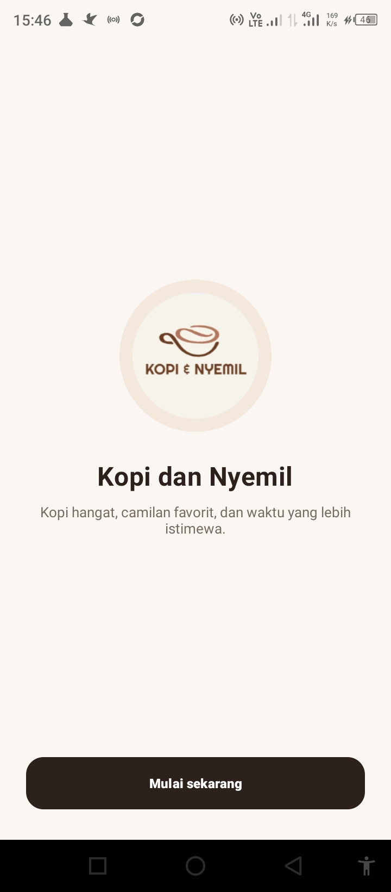
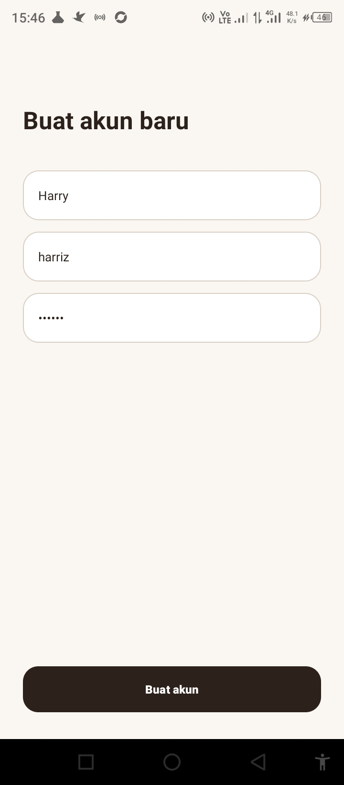
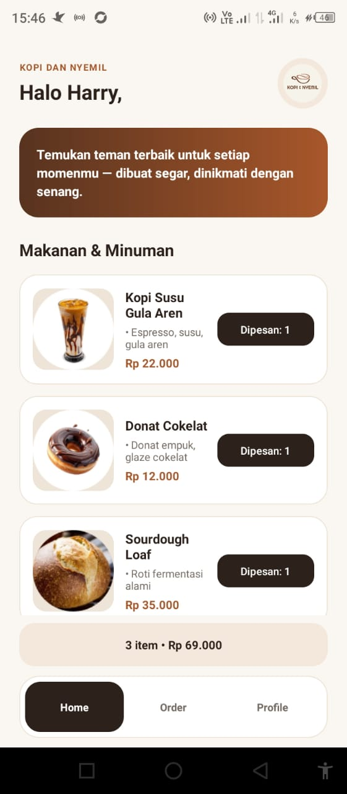
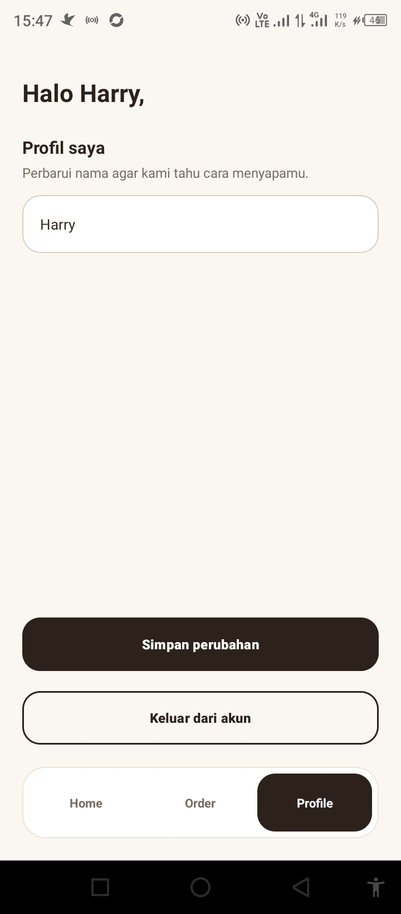

# Kopi dan Nyemil

Kopi dan Nyemil adalah aplikasi Android sederhana untuk menjelajahi menu kopi, minuman, dan camilan, menambahkan pilihan ke keranjang, lalu mengisi alamat untuk menyelesaikan pesanan. Aplikasi juga menyediakan alur pendaftaran, login, dan pengelolaan profil.


## Fitur

- Halaman pembuka dan navigasi ke pendaftaran atau login.
- Pendaftaran akun dengan validasi kolom wajib, panjang kata sandi minimal enam karakter, dan username unik.
- Login dengan akun yang telah terdaftar.
- Daftar menu beserta foto, deskripsi, dan harga.
- Menambahkan item ke keranjang dan melihat jumlah item serta total harga.
- Mengisi nama dan alamat pengiriman, lalu melihat konfirmasi pesanan.
- Mengubah nama profil dan logout.
- Navigasi antara halaman Home, Order, dan Profile.

## Teknologi

- **Bahasa:** Kotlin
- **Platform:** Android
- **Build system:** Gradle dengan Android Gradle Plugin
- **Android SDK:** compile/target SDK 34, minimum SDK 24
- **JDK:** 17
- **Library:** AndroidX Core KTX, AppCompat, Material Components, dan RecyclerView

## Menjalankan aplikasi

### Persyaratan

- Android Studio dengan Android SDK 34 terpasang.
- JDK 17.
- Emulator Android atau perangkat Android dengan USB debugging aktif.

### Melalui Android Studio

1. Buka folder proyek ini di Android Studio.
2. Tunggu proses Gradle Sync selesai.
3. Pilih emulator atau perangkat Android.
4. Jalankan konfigurasi `app` dengan tombol **Run**.

### Melalui terminal Windows

Dari folder utama proyek, jalankan:

```powershell
.\gradlew.bat :app:assembleDebug
```

APK debug akan dibuat di `app/build/outputs/apk/debug/app-debug.apk`. Untuk memasang APK ke perangkat/emulator yang terhubung melalui ADB:

```powershell
.\gradlew.bat :app:installDebug
```

### Akun demo

- **Username:** `demo`
- **Password:** `123456`

## Screenshot

Screenshot berikut tersedia di folder [`documentation`](documentation):

| Tampilan | Screenshot |
|---|---|
| Welcome |  |
| Sign Up |  |
| Register |  |
| Login User |  |
| Home |  |
| Alamat pengiriman |  |
| Konfirmasi pesanan |  |
| Profil |  |
